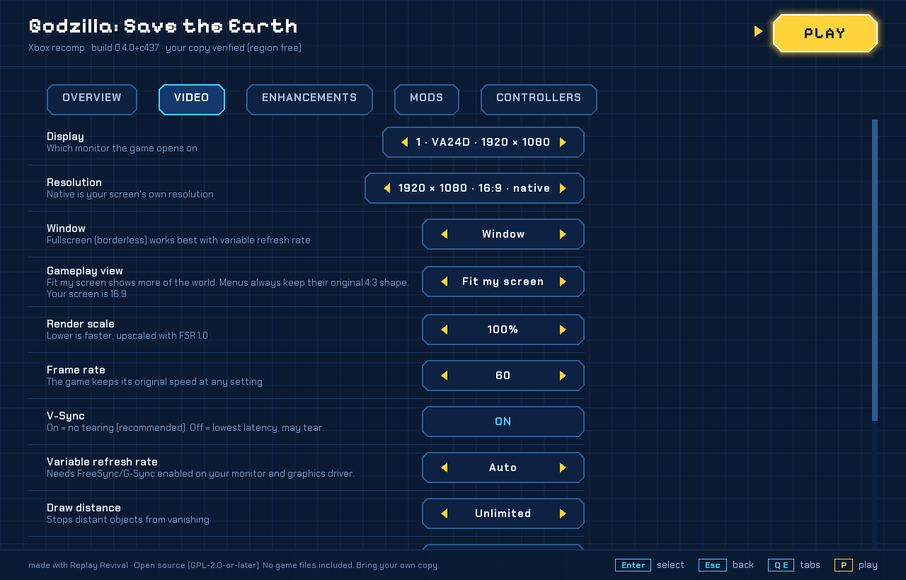
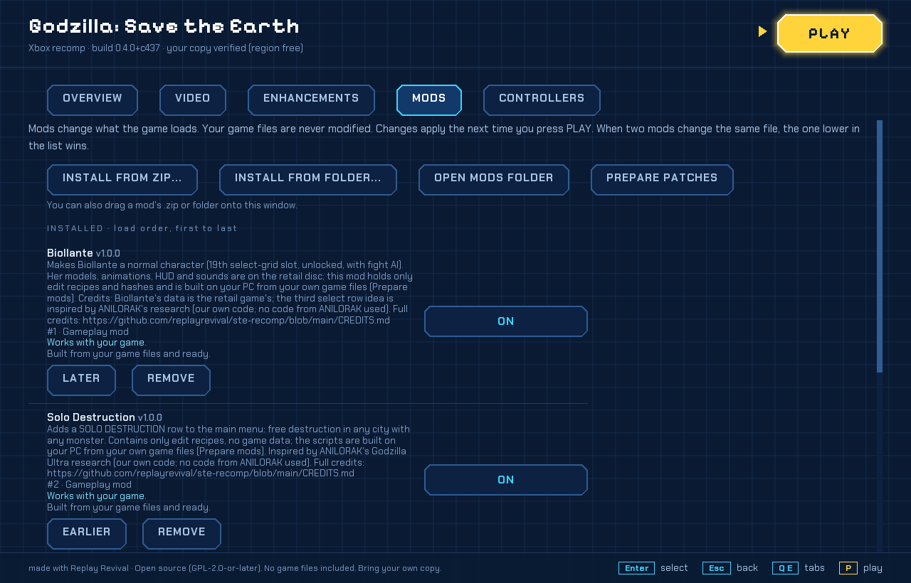
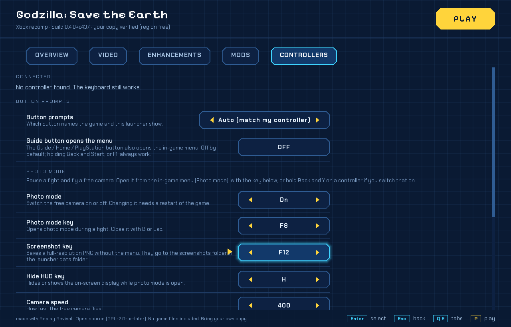
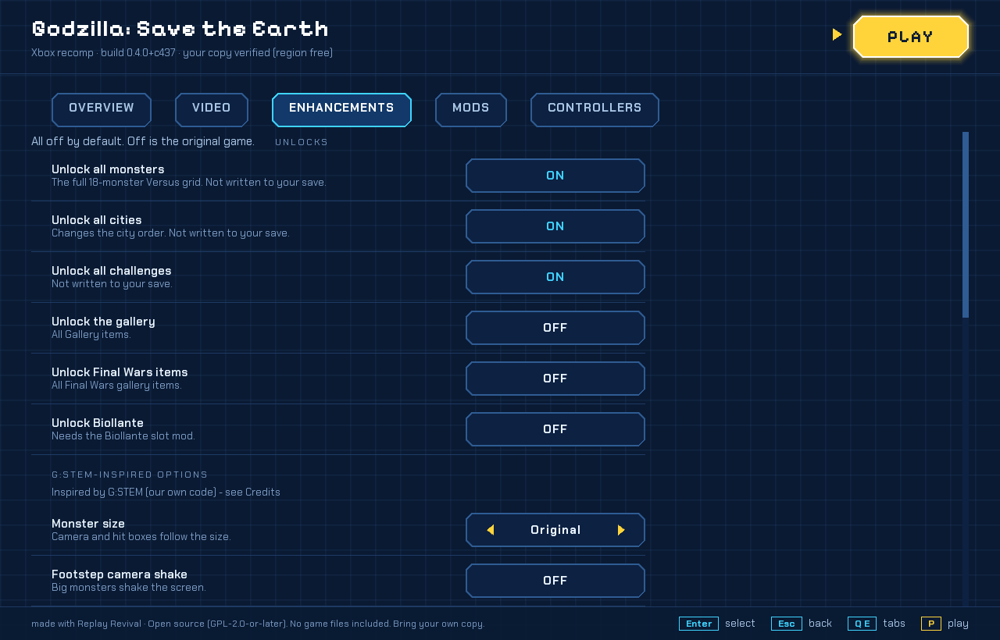

  

<h3 align="center">The launcher for Godzilla: Save the Earth on PC. Pick your settings, set up your controllers, manage mods and press Play.</h3>

  
  
  
  

## What it does

- **Finds your game.** Point it at your own copy of *Godzilla: Save the Earth* (a disc image or a folder). It checks that it is the right game. Your game files are only ever read, never changed.
- **Presets and settings.** Choose ORIGINAL, MAX or LOW-END, or change single options: resolution, widescreen, draw distance and more.
- **Controllers.** Set up each controller port, remap any button, and pick Xbox, PlayStation or original Xbox button pictures.
- **Mods.** Install mods from a zip or a folder, switch them on and off and set their order. Unsafe or damaged zips are refused.
- **In the game too.** The same screens open over the game (hold Back and Start, or press F1) so you can change settings or go back to the launcher without quitting first.
- **Plain messages.** If something is missing or the game stops, it says what happened and what to do. **Save crash report** makes a zip you can send yourself.
- **Works with a controller, keyboard or mouse.**

The game itself is in its own repository: **[replayrevival/ste-recomp](https://github.com/replayrevival/ste-recomp)**. The download on its [Releases](https://github.com/replayrevival/ste-recomp/releases/latest) page contains the game and this launcher together.

## What's new in v0.4.2

**After updating, press PLAY once:** the Mods tab says "Needs build" and the launcher rebuilds your script mods. Biollante is now unlocked on every profile when her mod is on; re-run Prepare mods after updating. The launcher swaps in the updated Biollante mod (1.0.1) at the next start (the old copy goes to the mods folder's `_removed` folder; your on/off choice stays).

- The download carries game build c460 (details in the [release notes](https://github.com/replayrevival/launcher/releases/tag/v0.4.2-alpha)).
- Credits: [CREDITS.md](CREDITS.md).

## What's new in v0.4.1 (hotfix)

**After updating, press PLAY once:** the Mods tab says "Needs build" and the launcher rebuilds your script mods. If you have the 0.4.0 Solo Destruction mod, the launcher swaps in the updated one at the next start (the old copy goes to the mods folder's `_removed` folder; your on/off choice stays).

- Solo Destruction and Biollante are built together in one go, because both now change the same menu file.
- The download carries the new mod tool `solo_ui.py` and the game build c441 (fixes in the [release notes](https://github.com/replayrevival/launcher/releases/tag/v0.4.1-alpha)).
- Credits: [CREDITS.md](CREDITS.md).

## What's new in v0.4.0

- **Biollante is playable.** The download carries the Biollante mod (switched off). Turn it on in the **Mods** tab, press Play, and the launcher builds it from your own game files (a few seconds, nothing is downloaded). She appears on a third row of the character select screen. Biollante's data is the retail game's; the third select row is inspired by ANILORAK's research (our own code; no code from ANILORAK used). Walkthrough: **[Mods that are built on your PC](docs/MODDING.md#mods-that-are-built-on-your-pc-script-mods)**; for modders: **[Add a monster to the roster](docs/MODDING.md#add-a-monster-to-the-roster)**.
- **Several script mods at once.** Solo Destruction and Biollante can both be on; the launcher builds them together and names both mods if they ever clash. The Mods tab says "Needs build" until it is done, and "Built from your game files and ready" after.
- **Solo Destruction** ships inside the download too, switched off. Inspired by ANILORAK's Godzilla Ultra research (our own code; no code from ANILORAK used).
- **Photo mode** settings on the Controllers tab (on/off, keys, camera speed, controller shortcut) and a PHOTO MODE button in the in-game menu.
- A small Python comes with the download, so nothing has to be installed. New guide section: [make a mod from a modified disc image or folder](docs/MODDING.md#make-a-mod-from-a-modified-disc-image-or-folder).
- **Credits:** [CREDITS.md](CREDITS.md) now has two parts: code and assets used, and research and inspiration (no code used). Full list for the game: https://github.com/replayrevival/ste-recomp/blob/main/CREDITS.md
- Known issues are listed in the [release notes](https://github.com/replayrevival/launcher/releases/tag/v0.4.0-alpha).

## Screenshots

| | |
|---|---|
|  |  |
| *Mods: Biollante and Solo Destruction, built from your own game files.* | *Video: resolution, widescreen, draw distance.* |
|  |  |
| *Controllers tab with the new Photo mode group.* | *The same screen with PlayStation pictures.* |
|  |  |
| *Video tab.* | *The built-in file browser.* |
|  | |
| *Enhancements: the G:STEM-inspired options and their credit.* | |
|  |  |
| *The same screens inside the game (Back+Start or F1).* | *The Enhancements page in the game, with the G:STEM credit.* |

## Not included
**No game files, game data or game executables are in this repository, and none will be accepted.** You must own the game. This is an unofficial fan project, not affiliated with or endorsed by the game's publishers or rights holders (Toho, Atari or Pipeworks). Game names are used only to say which games the launcher works with.

## Using it
See the [player guide](docs/PLAYER_GUIDE.md). Making mods: [modding guide](docs/MODDING.md).

---

# For developers

One launcher for every recomp: everything game-specific lives in `config/profile.json` (identity, game program, environment), `config/settings.json` (the options and presets) and `config/controls.json` (the controller actions).

- A disc image (.iso) is played straight from the image, read-only (when the game program reports `disc_image` in its `capabilities.json`; an older game program makes the launcher unpack it once into `data\game\`). An extracted folder is used in place.
- C++20, SDL3 + [RmlUi](https://github.com/mikke89/RmlUi) (OpenGL 3.3 behind `src/platform/UiBackend.h`, so another renderer can be added). The UI code takes a Context/Document and has no global window state, so it can be hosted in-game as an overlay.
- Optional, quiet update check once a day (can be switched off on the Overview tab). Details: [docs/NETWORK.md](docs/NETWORK.md).

## Build
See [BUILD.md](BUILD.md). Windows, Visual Studio / Build Tools, CMake; all libraries are vendored.

## Docs
- [docs/PLAYER_GUIDE.md](docs/PLAYER_GUIDE.md), [docs/MODDING.md](docs/MODDING.md): for players and mod makers.
- [docs/INPUT_MAPPING.md](docs/INPUT_MAPPING.md): controller mapping file the launcher writes and the game reads.
- [docs/INTERFACE_ASSUMPTIONS.md](docs/INTERFACE_ASSUMPTIONS.md): what the launcher expects from a game program.
- [docs/SCREEN_FLOW.md](docs/SCREEN_FLOW.md): the screens.
- [docs/MODS.md](docs/MODS.md): the Mods tab and install safety.
- [docs/OVERLAY.md](docs/OVERLAY.md): the in-game overlay.
- [docs/RELEASE_CHECKLIST.md](docs/RELEASE_CHECKLIST.md): how a release is made.
- [CREDITS.md](CREDITS.md), [THIRD_PARTY_NOTICES.md](THIRD_PARTY_NOTICES.md): dependencies, fonts and licences.

## Licence
GPL-2.0-or-later. `LICENSE` holds the GNU GPL version 2 text; you may also use any later version. Third-party code keeps its own licences (zlib, MIT, SIL OFL; FreeType under its GPLv2 option), see CREDITS.md.
