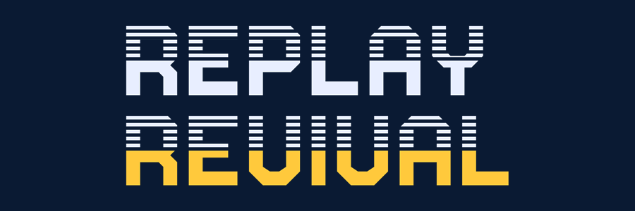
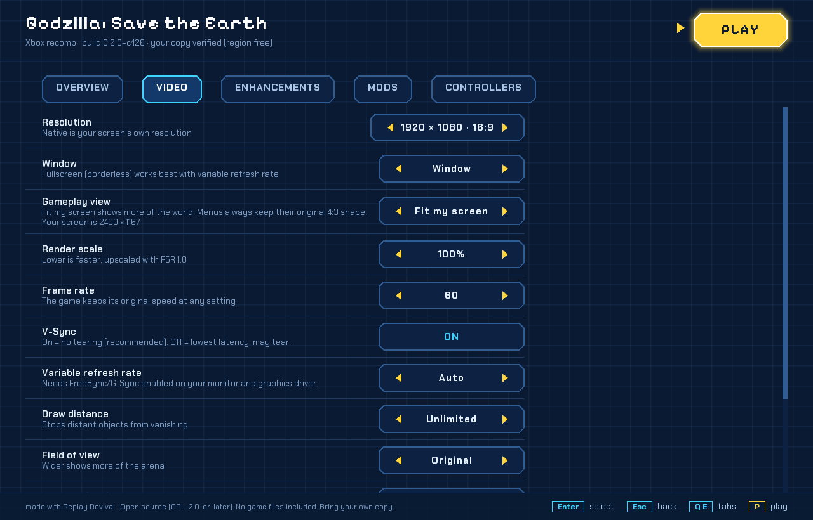
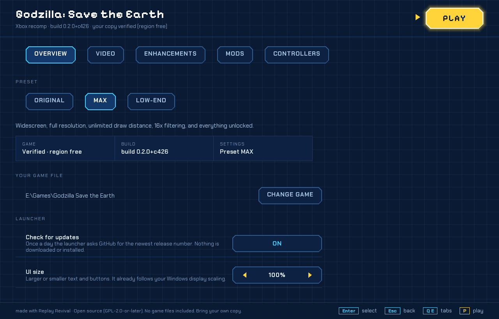
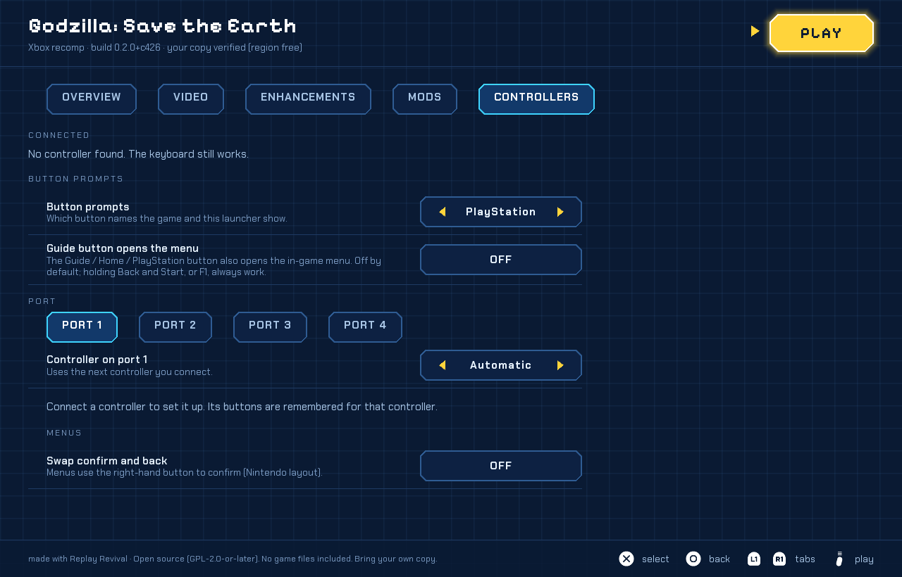
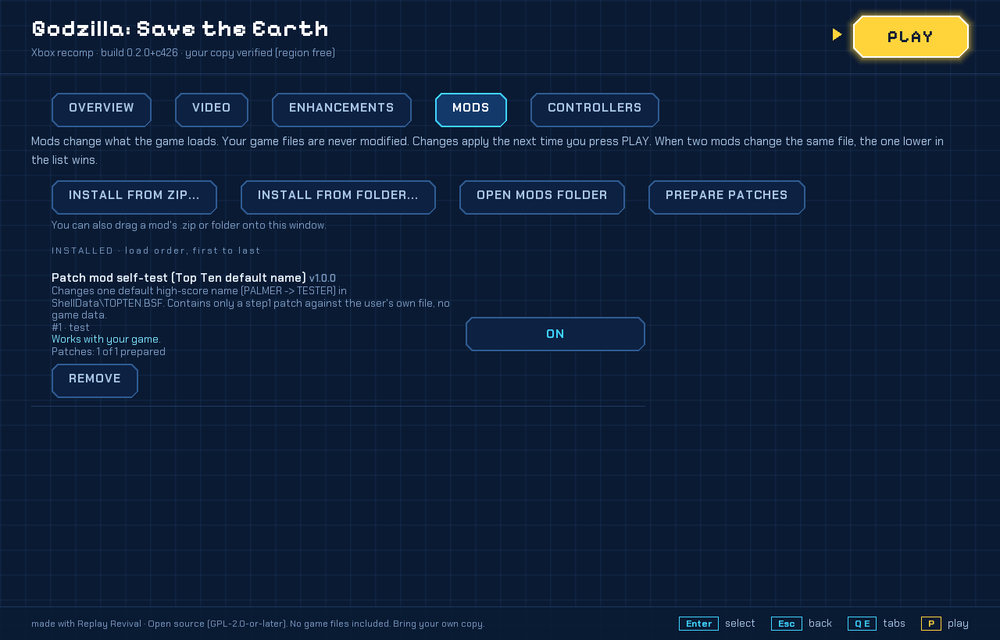
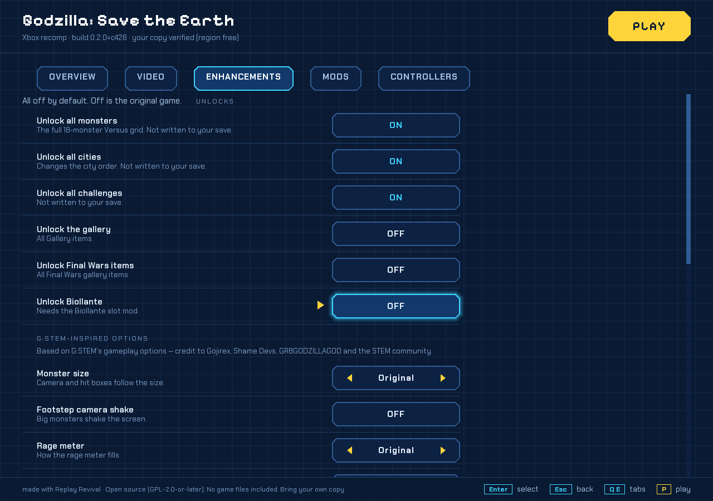
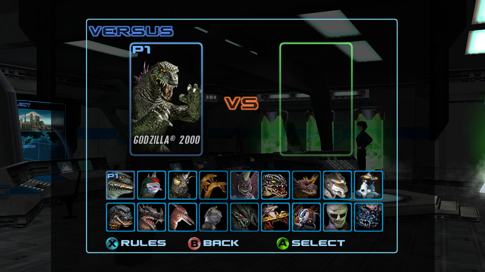
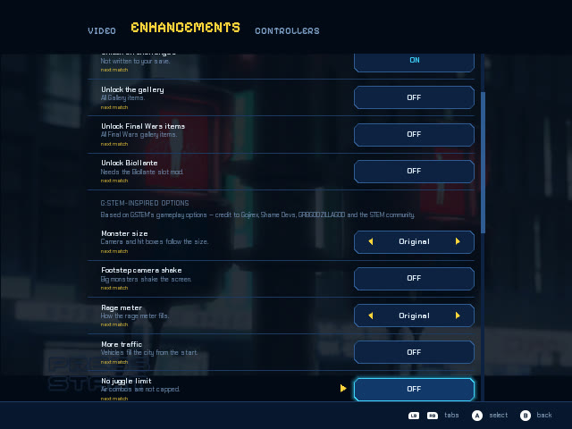



  

<h3 align="center">The launcher for Godzilla: Save the Earth on PC. Pick your settings, set up your controllers, manage mods and press Play.</h3>

  
  
  
  

## What it does

- **Finds your game.** Point it at your own copy of *Godzilla: Save the Earth* (a disc image or a folder). It checks that it is the right game. Your game files are only ever read, never changed.
- **Presets and settings.** Choose ORIGINAL, MAX or LOW-END, or change single options: resolution, widescreen, draw distance and more.
- **Controllers.** Set up each controller port, remap any button, and pick Xbox, PlayStation or original Xbox button pictures.
- **Mods.** Install mods from a zip or a folder, switch them on and off and set their order. Unsafe or damaged zips are refused.
- **In the game too.** The same screens open over the game (hold Back and Start, or press F1) so you can change settings or go back to the launcher without quitting first.
- **Plain messages.** If something is missing or the game stops, it says what happened and what to do. **Save crash report** makes a zip you can send yourself.
- **Works with a controller, keyboard or mouse.**

The game itself is in its own repository: **[replayrevival/ste-recomp](https://github.com/replayrevival/ste-recomp)**. The download on its [Releases](https://github.com/replayrevival/ste-recomp/releases/latest) page contains the game and this launcher together.

## What's new in v0.2.0

- **Play straight from your disc image.** Choose your .iso and press Play: the launcher no longer unpacks it into a folder first, and your image is only ever read. (An extracted game folder still works, and is needed for mods that change the game's own files.)
- **The in-game menu works with a controller alone.** Hold Back and Start (or press F1), move with the D-pad or left stick, A chooses, B goes back, **LB and RB switch between the Video, Enhancements and Controllers pages**, Start closes it. The pages show as a strip at the top. The menu no longer looks frozen in true full screen.
- **Fullscreen is now borderless fullscreen**, and the window mode has four choices: Window, Borderless window, Fullscreen (borderless) and Exclusive fullscreen (advanced, less tested).
- **Credit:** the Enhancements options that are based on G:STEM's gameplay options are grouped under "G:STEM-inspired options" (launcher tab and in-game menu). Based on G:STEM's gameplay options — credit to Gojirex, Shame Devs, GR8GODZILLAGOD and the STEM community.
- Known issues are listed in the [release notes](https://github.com/replayrevival/launcher/releases/tag/v0.2.0-alpha).

## Screenshots

| | |
|---|---|
|  |  |
| *Overview: presets and your game.* | *Video: resolution, widescreen, draw distance.* |
|  |  |
| *Controllers with Xbox button pictures.* | *The same screen with PlayStation pictures.* |
|  |  |
| *Mods tab.* | *The built-in file browser.* |
|  | |
| *Enhancements: the G:STEM-inspired options and their credit.* | |
|  |  |
| *The same screens inside the game (Back+Start or F1).* | *The Enhancements page in the game, with the G:STEM credit.* |

## Not included
**No game files, game data or game executables are in this repository, and none will be accepted.** You must own the game. This is an unofficial fan project, not affiliated with or endorsed by the game's publishers or rights holders (Toho, Atari or Pipeworks). Game names are used only to say which games the launcher works with.

## Using it
See the [player guide](docs/PLAYER_GUIDE.md). Making mods: [modding guide](docs/MODDING.md).

---

# For developers

One launcher for every recomp: everything game-specific lives in `config/profile.json` (identity, game program, environment), `config/settings.json` (the options and presets) and `config/controls.json` (the controller actions).

- A disc image (.iso) is played straight from the image, read-only (when the game program reports `disc_image` in its `capabilities.json`; an older game program makes the launcher unpack it once into `data\game\`). An extracted folder is used in place.
- C++20, SDL3 + [RmlUi](https://github.com/mikke89/RmlUi) (OpenGL 3.3 behind `src/platform/UiBackend.h`, so another renderer can be added). The UI code takes a Context/Document and has no global window state, so it can be hosted in-game as an overlay.
- Optional, quiet update check once a day (can be switched off on the Overview tab). Details: [docs/NETWORK.md](docs/NETWORK.md).

## Build
See [BUILD.md](BUILD.md). Windows, Visual Studio / Build Tools, CMake; all libraries are vendored.

## Docs
- [docs/PLAYER_GUIDE.md](docs/PLAYER_GUIDE.md), [docs/MODDING.md](docs/MODDING.md): for players and mod makers.
- [docs/INPUT_MAPPING.md](docs/INPUT_MAPPING.md): controller mapping file the launcher writes and the game reads.
- [docs/INTERFACE_ASSUMPTIONS.md](docs/INTERFACE_ASSUMPTIONS.md): what the launcher expects from a game program.
- [docs/SCREEN_FLOW.md](docs/SCREEN_FLOW.md): the screens.
- [docs/MODS.md](docs/MODS.md): the Mods tab and install safety.
- [docs/OVERLAY.md](docs/OVERLAY.md): the in-game overlay.
- [docs/RELEASE_CHECKLIST.md](docs/RELEASE_CHECKLIST.md): how a release is made.
- [CREDITS.md](CREDITS.md), [THIRD_PARTY_NOTICES.md](THIRD_PARTY_NOTICES.md): dependencies, fonts and licences.

## Licence
GPL-2.0-or-later. `LICENSE` holds the GNU GPL version 2 text; you may also use any later version. Third-party code keeps its own licences (zlib, MIT, SIL OFL; FreeType under its GPLv2 option), see CREDITS.md.
