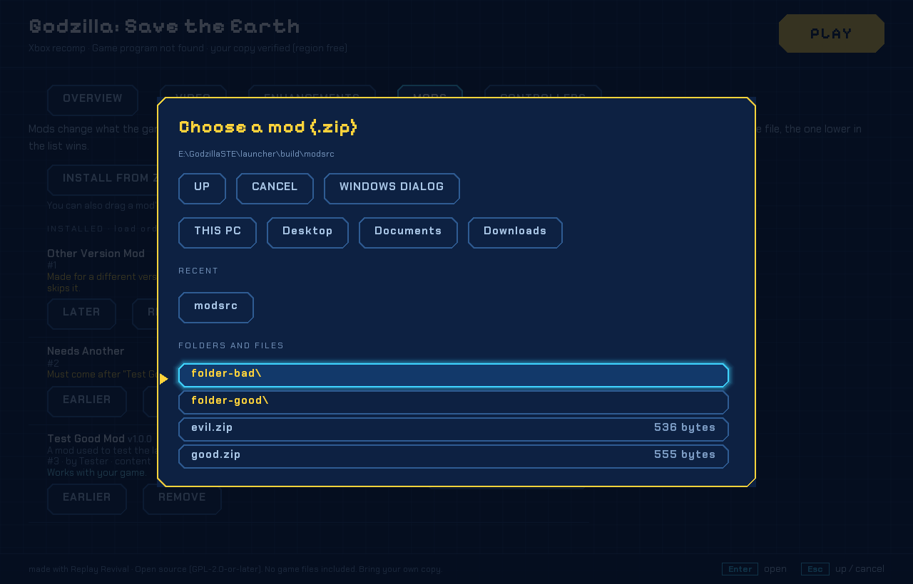
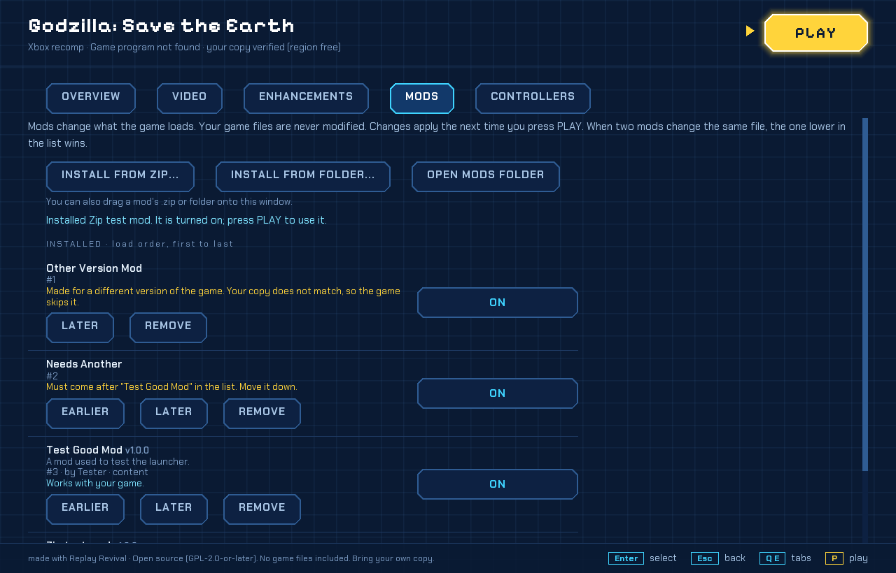
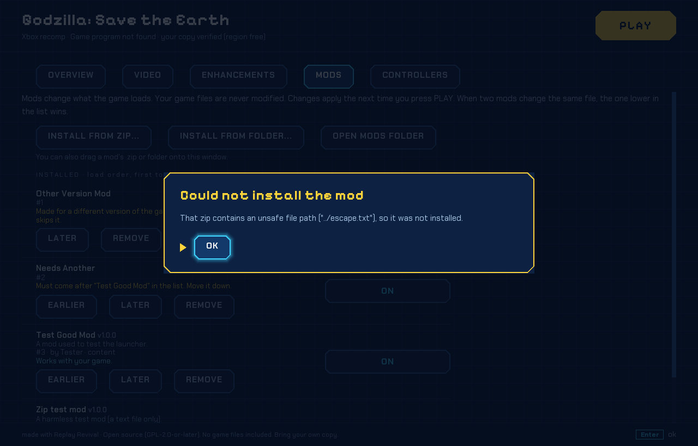

# Making mods

For people who want to make mods for the recompiled *Godzilla: Save the Earth*. Players: see [PLAYER_GUIDE.md](PLAYER_GUIDE.md).

**One rule above all: a mod never contains game data.** This project ships no mods and hosts none; you host yours. Either your mod holds only your own work, or it is a set of *patches* that turn the player's own game file into the modded one.

The exact formats are specified in the game project: `docs/formats/mod_manifest.md` (api 1) and `docs/formats/mod_patch.md` (api 2, patches). This page is the short version.

## 1. Layout
A mod is a folder (or a zip of that folder) named after its id:

```
author.my-mod\
  manifest.json          required
  ActionData\...         your own files, at game-relative paths (same names and case as in the game folder)
  ShellData\...
  patches\...            patch files (api 2, section 4)
  README.md              ignored by the game; say what the mod does and who made it
```
A file `author.my-mod\ActionData\x` replaces the game's `ActionData\x` whenever the game reads it. The game folder itself is never written. A zip may have `manifest.json` at its root or inside one top-level folder.

## 2. The manifest
```json
{
  "api": 1,
  "id": "author.my-mod",
  "name": "My mod",
  "version": "1.0.0",
  "game": "STE-Xbox",
  "game_hashes": ["sha256:6966cc8a3a22d420d05362f24f3e68d7a462c481861189855f05583c0d6de500"],
  "authors": ["Your name"],
  "license": "CC-BY-4.0",
  "description": "What it does, in one line.",
  "credits": [{"name": "Thing", "role": "model", "source": "https://...", "license": "CC0"}]
}
```
- `id` is required: letters, digits, `.`, `-`, `_` only. It becomes the folder name.
- `game_hashes` is the SHA-256 of the retail `default.xbe`. If it does not match the player's game, the mod is skipped and marked. Always set it.
- `dependencies` (ids that must be on and load first) and `conflicts` (ids that must not be on) are checked by both the launcher and the game.
- `credits` lists every resource you did not make yourself, with its licence. Check that the licence lets you share it.

## 3. Load order
Later mods win when two change the same file. The player sets the order in the Mods tab; the launcher writes `order.json` and the game writes `mods\last_report.txt` at every start, listing what is ACTIVE or SKIPPED and why.

## 4. Patch mods (mod_patch v1, api 2)
Use a patch when your change is to a game file you must not share (a model, a bundle, a script that is mostly the original's). You publish only the difference.

Add to the manifest (`"api": 2`):
```json
"patches": [{
  "target": "bundle\\MechaGodzilla3.cmf",
  "base_sha256": "sha256:<hash of the ORIGINAL file>",
  "result_sha256": "sha256:<hash of YOUR modified file>",
  "patch": "patches\\MechaGodzilla3.cmf.step",
  "size": 3412480
}]
```
One entry per patched file; each is checked against its own original. If the player's file does not match `base_sha256` nothing is applied. If the result does not match `result_sha256` it is thrown away. Two mods can patch the same file only if the second one's `base_sha256` is the first one's `result_sha256`.

### Making a patch
With the repo's tool `step_patch_tool` (build it with `cmake --build build --target step_patch_tool`):

```
step_patch_tool hash   <file>                              prints the SHA-256 (for the manifest)
step_patch_tool make   <original> <modified> <out.step>    writes the patch
step_patch_tool check  <original> <out.step> <modified>    applies it and compares
```
Add `--raw` to `make` to skip compression. The tool is a simple first version: it keeps the common start and end of the file and stores the middle. Small edits give small patches; large edits in the middle give large ones. A better encoder is planned.

Steps:
1. Copy your own original file out of your game folder and keep it untouched.
2. Make your modified file with your own tools.
3. `hash` both, `make` the patch, `check` it, and fill in the manifest.
4. Zip the mod folder. It must contain **no** original and no modified game file, only the patch and your own work.

## 4b. Install and verify
- **Install:** Mods tab, **INSTALL FROM ZIP** or **FROM FOLDER** (or drag it onto the window). The launcher checks the zip first and refuses anything with paths that climb out of the mod folder, encrypted entries or oversized contents. A mod with the same id asks before replacing it; the old copy is moved aside.



A good mod is installed and switched on; one that is not safe or not valid is refused with a plain message and nothing is installed:




Examples of refusals: a zip with a file path that climbs out of the mod folder, a folder without `manifest.json`, an id with characters other than letters, digits, `.`, `-`, `_`.

- **Verify:** the badge says "Works with your game" or why not. For patch mods the launcher reads the player's own file (read only), checks its hash, builds the result into `mods\<id>\_built\` and checks that hash too. PLAY does this for you; PREPARE PATCHES does it by hand. Failures are per patch: "made for a different version of the game" (shows both hashes), "result did not match", "damaged patch".
- **Test it yourself:** install on a clean copy, press PLAY, then read `data\mods\last_report.txt` for `ACTIVE` lines. Also test removing the mod and starting again.

Game side: since game build c376 (v0.1.4) the game uses `_built\<target>` of an enabled api-2 mod when its SHA-256 equals `result_sha256` of the manifest; a missing or wrong file falls back to your original and is logged (`[MODS]   patch <target>: not built ...` / `RESULT MISMATCH ...`). The game does not build `_built\` itself: the launcher does it (PLAY prepares patches first, or the PREPARE PATCHES button). Checked end to end with the self-test mod: the game log says `built file verified ..., used`.

## 5. Credits and licence
- Give your mod a licence in the manifest and say who made what.
- Credit everything you reused in `credits`. Do not include material you may not redistribute.
- You may not include game data, even "just a little", and you may not ship the player's original file inside a patch (the format has no way to do that on purpose).
- The launcher and tools are GPL-2.0-or-later; that does not apply to your mod's own files.

## 6. Worked example: Biollante
*Reserved.* This section will walk through restoring Biollante from the files already on the disc as her own roster slot, as a real patch mod: what was changed, how the patches were made and checked, and the finished manifest. It will be written when that mod is ready.

## 7. Not supported yet
- `bsdiff40` patches.
- Texture packs (`texturepacks\`) have their own folder and are not in the Mods tab yet.
