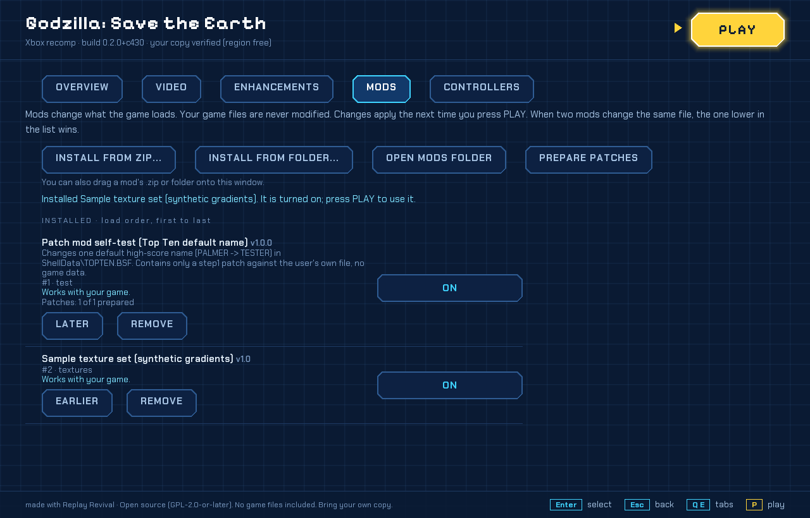

# Modding guide

For people who want to change or add to *Godzilla: Save the Earth* on PC (the recompiled game). Players: see [PLAYER_GUIDE.md](PLAYER_GUIDE.md).

**One rule above all: a mod never contains game data.** This project ships no mods and hosts none; you host yours. Your mod holds only your own work, or it is a set of *patches* (only the difference from the player's own file).

Contents: [Start here](#start-here) · [Retexture a monster](#retexture-a-monster) · [Install and share a mod](#install-and-share-a-mod) · [Patch mods](#patch-mods) · [Settings and tweaks you can change](#settings-and-tweaks-you-can-change) · [Troubleshooting and FAQ](#troubleshooting-and-faq) · [What's changed for modders](#whats-changed-for-modders)

## Start here

**What you can mod today**

| I want to... | Use | Walkthrough |
|---|---|---|
| Repaint a monster or other textures (HD or just different) | a *texture pack* | [Retexture a monster](#retexture-a-monster) |
| Replace or add game files (data, scripts, sounds) with my own work | a *file mod* | [Install and share a mod](#install-and-share-a-mod) |
| Change a game file I must not share (a model, a bundle) | a *patch mod* | [Patch mods](#patch-mods) |
| Change how the game plays (rage meter, cheats, size, ...) | settings, no mod needed | [Settings and tweaks](#settings-and-tweaks-you-can-change) |

**What you need**
- Your own copy of the game (the Xbox disc image or an extracted folder). Your files are only ever read.
- The launcher and game from the [latest release](https://github.com/replayrevival/ste-recomp/releases/latest).
- For the texture tools: **Python 3.9 or newer** (python.org, tick "Add python.exe to PATH") and the Pillow library: open a Command Prompt and type `pip install Pillow`.
- An image editor for textures (anything that saves PNG: GIMP, Krita, Photoshop, Paint.NET).

**Where mods go**
- Mods you install in the launcher live in the launcher's data folder: `data\mods\<id>\` (Mods tab > OPEN MODS FOLDER opens it). You do not need to copy anything by hand.
- The game writes `data\mods\last_report.txt` at every start: it lists what is ACTIVE or SKIPPED and why. Look there first when something does not show.

Technical detail (file formats, keys) lives in the game project's `docs\formats\` and is linked from here, not repeated.

## Retexture a monster

Five steps: **export** the original pictures, **edit** them, **import** them into a pack, **install** the pack, **share** it. About 15 minutes for the first monster.

**1. Export the monster's textures from your own game.** Open a Command Prompt in the folder that holds `import_texture_set.py` (it is in the game project's `tools\mods\`) and type (use your own paths):

```
python import_texture_set.py export "D:\Games\Godzilla Save the Earth" gigan_original --monster Gigan
```
- The game can be the folder or the `.iso` itself.
- `--monster ?` lists the monster names (Gigan, Godzilla2k, MechaGodzilla3, ...). `--monster` takes every picture of that monster: skin, bump map, weapons, effects and its HUD pictures. Use `--match Word1,Word2` for single textures and `--list` to only print names.
- You get PNG files named exactly like the game's textures, for example `Gigan_G2_512_C.png` (the **colour** skin) and `Gigan_G2_512_B.png` (the **bump map**; edit it only if you know what a bump map is). `export_report.csv` lists everything that was written.
- The game has one skin set per monster (there are no separate far-distance skins).

**2. Edit.** Copy the PNGs you want to change into a new folder (say `my_edits`) and paint over them. Rules:
- Keep the **file name** and keep the **same width/height ratio** (square stays square). Higher resolution is fine (up to 8192 pixels); the game builds the smaller copies itself.
- Keep transparency (alpha) where the original has it. Save as 8-bit PNG.
- Only put the pictures you changed in `my_edits`. The ones you leave out stay original.
- Only use pictures you made yourself or may share. The exported originals belong to the game's owners: never share them.

**3. Import into a texture pack.** One time per game copy, build the index (about 7 seconds), then import:

```
python import_texture_set.py index "D:\Games\Godzilla Save the Earth" xbox_texture_index.csv
python import_texture_set.py import my_edits xbox_texture_index.csv my_gigan_pack --id my-gigan --name "My Gigan retexture" --credits "your name, own work, CC0"
```
You get a folder `my_gigan_pack` with your pictures renamed to what the game expects, a `manifest.json` and `report.csv`. Open `report.csv`: every line should say `matched`. `unmatched` means the name is wrong (the tool suggests the closest names); `size-mismatch` means the shape differs from the original (it is still written, but check it looks right in the game).

**4. Install.** In the launcher open **Mods**, then **INSTALL FROM FOLDER...** and choose `my_gigan_pack` (or drag the folder onto the launcher window). It shows "Installed ... It is turned on; press PLAY to use it." Switch it ON or OFF in the list. Press **PLAY** and look at the monster.



> Needs a game build that loads texture packs from the Mods tab (the release notes say from which version). On older builds copy the pack folder into `texturepacks\` next to `ste-recomp.exe` and set `"enabled": true` in its `manifest.json`.

**5. Share.** Zip the `my_gigan_pack` folder (the zip holds your PNGs and `manifest.json`, never the game's originals) and put it on your own page. Say who made it, add a licence and credit anything you reused in `--credits`. The launcher users install it with **INSTALL FROM ZIP...**.

Details of the file name key, the pack format and the loader: game project `docs\formats\texturepack.md` and `texturepack_import.md`.

## Install and share a mod

A *file mod* is a folder (or a zip of that folder) named after its id. A file `author.my-mod\ActionData\x` replaces the game's `ActionData\x` whenever the game reads it (same names and case as in the game folder).

```
author.my-mod\
  manifest.json          required
  ActionData\...         your own files, at game-relative paths
  ShellData\...
  README.md              ignored by the game; say what the mod does and who made it
```

**The manifest**
```json
{
  "api": 1,
  "id": "author.my-mod",
  "name": "My mod",
  "version": "1.0.0",
  "game": "STE-Xbox",
  "game_hashes": ["sha256:6966cc8a3a22d420d05362f24f3e68d7a462c481861189855f05583c0d6de500"],
  "authors": ["Your name"],
  "license": "CC-BY-4.0",
  "description": "What it does, in one line.",
  "credits": [{"name": "Thing", "role": "model", "source": "https://...", "license": "CC0"}]
}
```
- `id` is required: letters, digits, `.`, `-`, `_` only. It becomes the folder name.
- `game_hashes` is the SHA-256 of the retail `default.xbe`. If it does not match the player's game, the mod is skipped and marked. Always set it.
- `dependencies` (ids that must be on and load first) and `conflicts` (ids that must not be on) are checked by both the launcher and the game.
- `credits` lists every resource you did not make yourself, with its licence.

**Install.** Mods tab, **INSTALL FROM ZIP...** or **FROM FOLDER...** (or drag it onto the window). The launcher checks a zip first and refuses anything with paths that climb out of the mod folder, encrypted entries or oversized contents. A mod with the same id asks before replacing it; the old copy is moved aside.


A good mod is installed and switched on; one that is not safe or not valid is refused with a plain message and nothing is installed:


**Load order.** Later mods win when two change the same file. Set the order with EARLIER / LATER in the Mods tab. The launcher writes `order.json`; the game writes `last_report.txt`.

**Test it yourself.** Install on a clean copy, press PLAY, read `data\mods\last_report.txt` for `ACTIVE` lines, then remove the mod and start again.

**Share.** Zip the folder (manifest at the top or inside one folder), give it a licence in the manifest, credit what you reused, and host it yourself. You may not include game data, even "just a little". The launcher and tools are GPL-2.0-or-later; that does not apply to your mod's own files.

## Patch mods

Use a patch when your change is to a game file you must not share (a model, a bundle, a script that is mostly the original's). You publish only the difference. Format: game project `docs\formats\mod_patch.md`.

Add to the manifest (`"api": 2`):
```json
"patches": [{
  "target": "bundle\\MechaGodzilla3.cmf",
  "base_sha256": "sha256:<hash of the ORIGINAL file>",
  "result_sha256": "sha256:<hash of YOUR modified file>",
  "patch": "patches\\MechaGodzilla3.cmf.step",
  "size": 3412480
}]
```
One entry per patched file. If the player's file does not match `base_sha256` nothing is applied; if the result does not match `result_sha256` it is thrown away. Two mods can patch the same file only if the second one's `base_sha256` is the first one's `result_sha256`.

**Making a patch** with the project's `step_patch_tool` (build it with `cmake --build build --target step_patch_tool`):
```
step_patch_tool hash   <file>                              prints the SHA-256 (for the manifest)
step_patch_tool make   <original> <modified> <out.step>    writes the patch
step_patch_tool check  <original> <out.step> <modified>    applies it and compares
```
1. Copy your own original file out of your game folder and keep it untouched.
2. Make your modified file with your own tools.
3. `hash` both, `make` the patch, `check` it, and fill in the manifest.
4. Zip the mod folder. It must contain **no** original and no modified game file, only the patch and your own work.

Small edits give small patches (the tool keeps the common start and end and stores the middle; add `--raw` to skip compression). Install it like any mod. The launcher reads the player's own file (read only), checks its hash, builds the result into `mods\<id>\_built\` and checks that hash too; PLAY does this for you, **PREPARE PATCHES** does it by hand. Failures are per patch: "made for a different version of the game" (shows both hashes), "result did not match", "damaged patch". Patch mods need an unpacked game folder (they are not applied when you play straight from a disc image).

## Settings and tweaks you can change

These are the options in the launcher (Video and Enhancements tabs) and in the in-game menu (hold Back and Start, or F1). They are saved in `ste_video.ini` and `ste_enhance.ini` (in the launcher's `data\game_settings\`) and can also be set for one run with an environment variable. Off, or the first value, is the original game.

<!-- SETTINGS:BEGIN (generated by scripts/gen_modding_settings.py from config/settings.json: do not edit by hand) -->
### Video

| Option (launcher and in-game menu) | What it does | Values | Setting in the ini file | Default |
|---|---|---|---|---|
| Display | Which monitor the game opens on |  |  |  |
| Resolution | Native is your screen's own resolution |  |  |  |
| Window | Fullscreen (borderless) works best with variable refresh rate | Window, Borderless window, Fullscreen (borderless), Exclusive fullscreen (advanced) | `ste_video.ini` `[video]` `mode` | `window` |
| Gameplay view | Fit my screen shows more of the world. Menus always keep their original 4:3 shape | Original (4:3), Fit my screen | `ste_video.ini` `[video]` `aspect` | `4:3-pillar` |
| Render scale | Lower is faster, upscaled with FSR 1.0 | 100%, 85%, 75%, 67%, 50% | `ste_video.ini` `[video]` `render_scale` |  |
| Frame rate | The game keeps its original speed at any setting | 60, 30, Uncapped | `ste_video.ini` `[video]` `fps_cap` | `60` |
| V-Sync | On = no tearing (recommended). Off = lowest latency, may tear. | ON / OFF | `ste_video.ini` `[video]` `vsync` | `off` |
| Variable refresh rate | Needs FreeSync/G-Sync enabled on your monitor and graphics driver. | Auto, Off | `ste_video.ini` `[video]` `vrr` | `auto` |
| Draw distance | Stops distant objects from vanishing | Original, 2x, 4x, Unlimited | `ste_video.ini` `[video]` `draw_distance` | `1` |
| Field of view | Wider shows more of the arena | Original, Wider, Widest | `ste_video.ini` `[video]` `fov_scale` | `1` |
| Texture filtering | Sharper surfaces at an angle | Off, 2x, 4x, 8x, 16x | `ste_video.ini` `[video]` `anisotropy` | `0` |
| **SOUND AND POINTER** |  | | | |
| Volume | The game's overall volume. | 0% (mute), 10%, 20%, 30%, 40%, 50%, 60%, 70%, 80%, 90%, 100% | `ste_video.ini` `[audio]` `master_volume` | `100` |
| Mouse pointer | Auto hides it after 3 seconds without movement. | Auto, Always hidden, Always shown | `ste_video.ini` `[window]` `hide_cursor` | `auto` |
| **HD ART** |  | | | |
| HD art | Sharper replacement pictures, made for this game. Needs the HD art files. (shown only when the game reports `hd_art`) | ON / OFF | `ste_video.ini` `[video]` `hd_art` | `0` |
| Sky | Replacement sky pictures. Only used while HD art is on. (shown only when the game reports `hd_art`) | On, Off | `ste_video.ini` `[video]` `hd_art_sky` | `1` |
| Ground | Replacement ground pictures. Only used while HD art is on. (shown only when the game reports `hd_art`) | On, Off | `ste_video.ini` `[video]` `hd_art_ground` | `1` |
| Roofs | Replacement roof pictures. Only used while HD art is on. (shown only when the game reports `hd_art`) | On, Off | `ste_video.ini` `[video]` `hd_art_roofs` | `1` |
| Billboards | Replacement billboard pictures. Only used while HD art is on. (shown only when the game reports `hd_art`) | On, Off | `ste_video.ini` `[video]` `hd_art_billboards` | `1` |

### Enhancements

| Option (launcher and in-game menu) | What it does | Values | Setting in the ini file | Default |
|---|---|---|---|---|
| **UNLOCKS** |  | | | |
| Unlock all monsters | The full 18-monster Versus grid. Not written to your save. | ON / OFF | `ste_enhance.ini` `[enhance]` `unlock_all_monsters` | `0` |
| Unlock all cities | Changes the city order. Not written to your save. | ON / OFF | `ste_enhance.ini` `[enhance]` `unlock_all_cities` | `0` |
| Unlock all challenges | Not written to your save. | ON / OFF | `ste_enhance.ini` `[enhance]` `unlock_all_challenges` | `0` |
| Unlock the gallery | All Gallery items. | ON / OFF | `ste_enhance.ini` `[enhance]` `unlock_gallery` | `0` |
| Unlock Final Wars items | All Final Wars gallery items. | ON / OFF | `ste_enhance.ini` `[enhance]` `unlock_final_wars` | `0` |
| Unlock Biollante | Needs the Biollante slot mod. | ON / OFF | `ste_enhance.ini` `[enhance]` `unlock_biollante` | `0` |
| **G:STEM-INSPIRED OPTIONS** | Based on G:STEM's gameplay options — credit to Gojirex, Shame Devs, GR8GODZILLAGOD and the STEM community. | | | |
| Monster size | Camera and hit boxes follow the size. | Original, 150%, 200%, 300% | `ste_enhance.ini` `[enhance]` `stem_rule_player_size` | `0` |
| Footstep camera shake | Big monsters shake the screen. | ON / OFF | `ste_enhance.ini` `[enhance]` `stem_footstep_camera_shake` | `0` |
| Rage meter | How the rage meter fills. | Original, Damage taken, Damage dealt, Both, Over time, All | `ste_enhance.ini` `[enhance]` `stem_rule_rage_meter` | `0` |
| More traffic | Vehicles fill the city from the start. | ON / OFF | `ste_enhance.ini` `[enhance]` `stem_more_ai_vehicles` | `0` |
| No juggle limit | Air combos are not capped. | ON / OFF | `ste_enhance.ini` `[enhance]` `stem_no_juggle_limit` | `0` |
| No knockback scaling |  | ON / OFF | `ste_enhance.ini` `[enhance]` `stem_no_knockback_scaling` | `0` |
| No minimum health |  | ON / OFF | `ste_enhance.ini` `[enhance]` `stem_no_min_health` | `0` |
| Weapon-independent vertical knockback |  | ON / OFF | `ste_enhance.ini` `[enhance]` `stem_weapon_vertical_knockback` | `0` |
| No results-screen dimming |  | ON / OFF | `ste_enhance.ini` `[enhance]` `stem_no_results_dim` | `0` |
| Empty arena | Flat ground, no buildings. | ON / OFF | `ste_enhance.ini` `[enhance]` `stem_rule_empty_arena` | `0` |
| **GODZILLA ULTRA FEATURES** | Based on ANILORAK's Godzilla Ultra research. | | | |
| **CHEATS** |  | | | |
| Player 1 invulnerable | Checked against the real game. | ON / OFF | `ste_enhance.ini` `[enhance]` `cheat_invulnerable_p1` | `0` |
| Computer player invulnerable |  | ON / OFF | `ste_enhance.ini` `[enhance]` `cheat_invulnerable_com` | `0` |
| Computer player super damage |  | ON / OFF | `ste_enhance.ini` `[enhance]` `cheat_super_damage_com` | `0` |
| Player 1 red |  | ON / OFF | `ste_enhance.ini` `[enhance]` `cheat_red_p1` | `0` |
| Computer player red |  | ON / OFF | `ste_enhance.ini` `[enhance]` `cheat_red_com` | `0` |
| **SAVES** |  | | | |
| Start with the game folder's saves | Off starts empty, like a new console. | ON / OFF | `ste_saves.ini` `[saves]` `seed_from_game_dir` | `0` |

### Presets

| Preset | What it does |
|---|---|
| ORIGINAL | Exactly how it looked on the console: original aspect, original draw distance, nothing extra. |
| MAX | Widescreen, full resolution, unlimited draw distance, 16x filtering, and everything unlocked. |
| LOW-END | 1080p output rendered at 720p and sharpened with FSR 1.0, for older PCs and handhelds. |

Every key can also be set for one run with the environment variable `STE_<SECTION>_<KEY>` (see the game project's `docs/LAUNCHER_INTERFACE.md`). Off, or the first value, is the original game.
<!-- SETTINGS:END -->

## Troubleshooting and FAQ

**My mod does not show in the Mods tab.** Is there a `manifest.json` at the top of the folder (or inside one top-level folder of the zip)? Is the `id` only letters, digits, `.`, `-`, `_`? The launcher shows a plain message when it refuses something.

**It shows "made for a different version of the game".** `game_hashes` does not contain the SHA-256 of the player's `default.xbe`. Check the hash with `step_patch_tool hash default.xbe`, or drop the field only for your own testing.

**The mod is installed but nothing changes in the game.** Is it switched ON? Press PLAY again (changes apply at the next start). Read `data\mods\last_report.txt`: it says ACTIVE or SKIPPED and why. A file mod replaces files by their path: names and upper/lower case must match the game folder exactly.

**Texture pack: `unmatched` in report.csv.** The PNG name is not a game texture name. Run the export again with `--list` and `--match` to see the real names; copy the exact name.

**Texture pack: `size-mismatch`.** The new picture has a different shape (width:height) than the original. It is still written, but it may look stretched.

**My texture is installed, but the monster looks the same.** Check `last_report.txt` and the game log line `[TEXPACK] <id> ... ACTIVE`. The monster may use another texture (try `--monster` for all of them), or the pack is switched off.

**`python` is not recognised.** Reinstall Python and tick "Add python.exe to PATH", or run `py import_texture_set.py ...`.

**`Pillow is missing`.** Type `pip install Pillow`.

**Can I put the original textures or files in my mod?** No. Never share game data.

**Does my mod work if the player runs the game from a disc image?** File mods and texture packs do. Patch mods need an unpacked game folder.

**Where do I report problems?** https://github.com/replayrevival/ste-recomp/issues

## What's changed for modders

- **0.2.2 (next)**: texture export (`import_texture_set.py export`) to get a monster's original textures as named PNGs; texture packs installed in the Mods tab are loaded by the game from the Mods folder, with the Mods tab's ON/OFF and order; this guide restructured with a generated settings reference.
- **0.2.1**: no change for modders.
- **0.2.0**: play straight from a disc image (file mods and texture packs work; patch mods need an unpacked folder). The Enhancements settings that come from G:STEM are grouped as "G:STEM-inspired options" (credit in the launcher and the in-game menu).
- **0.1.7**: the texture pack import tool and texture pack loader are described in the game project's `docs\formats\texturepack*.md`.
- **0.1.4**: patch mods (api 2) and the Mods tab.
