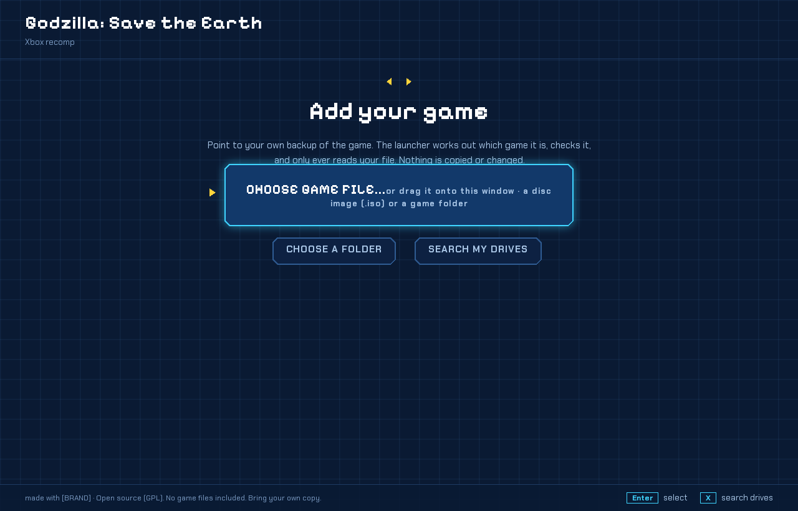
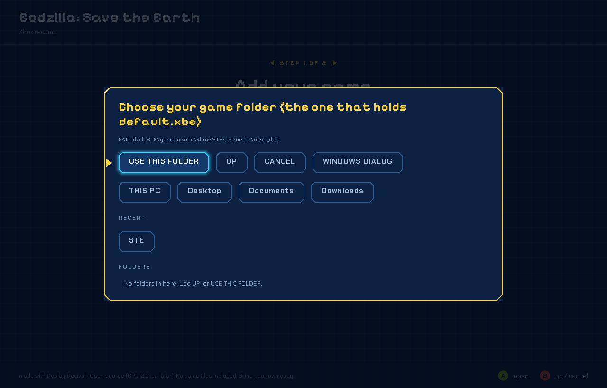
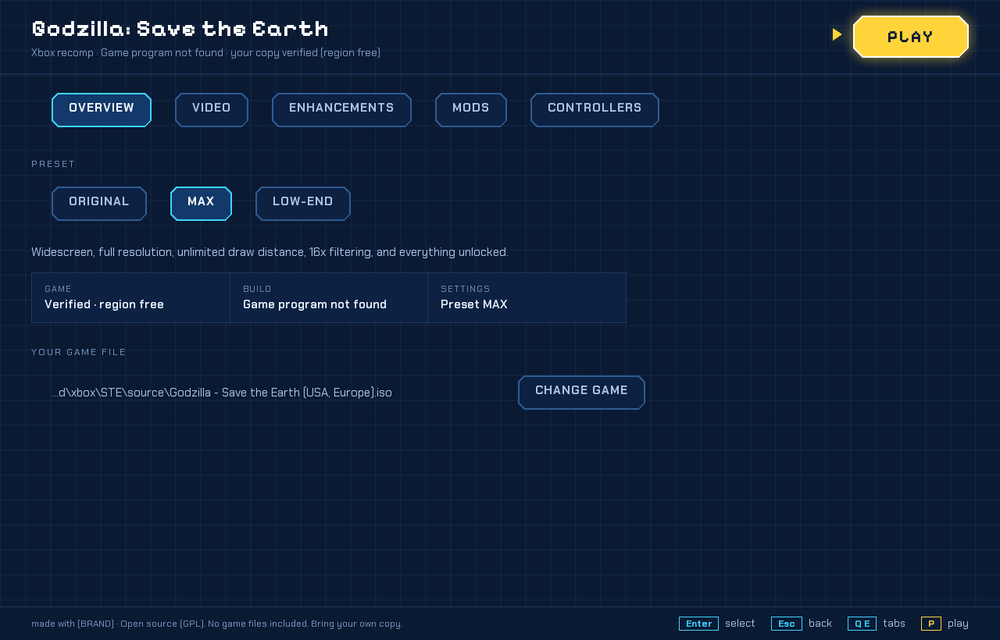
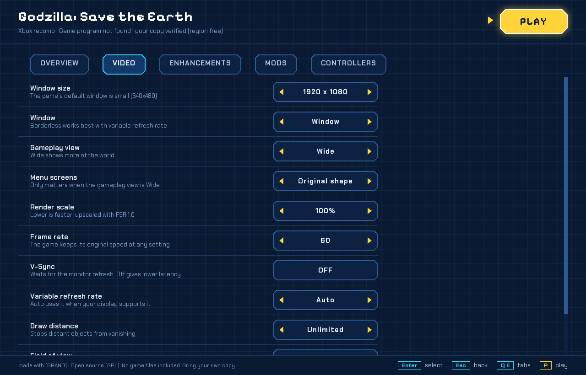
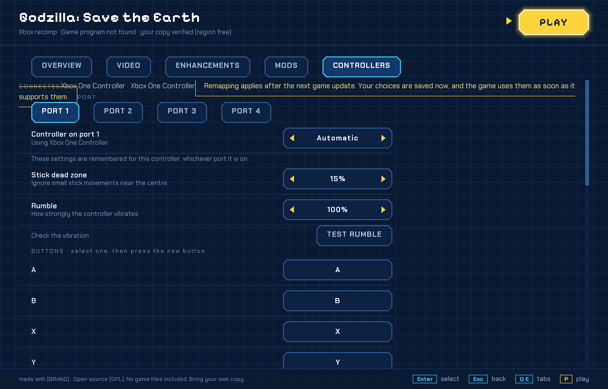
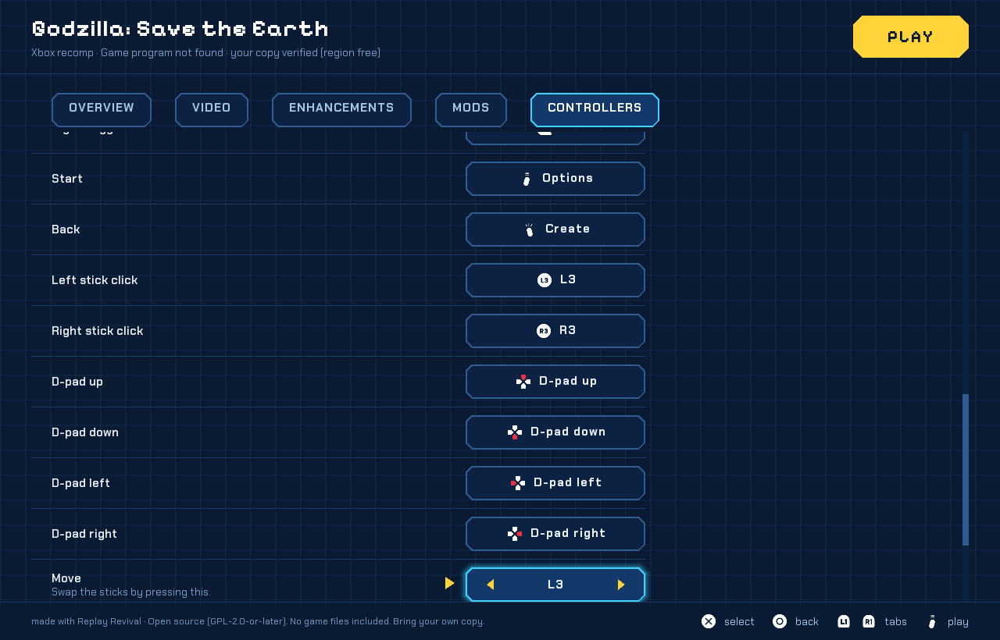
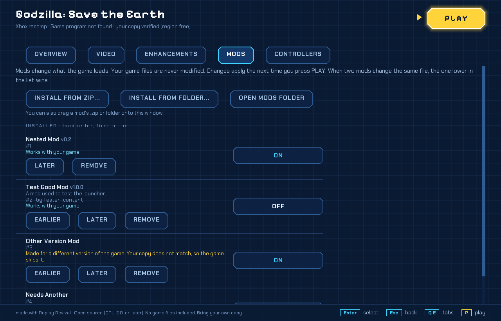
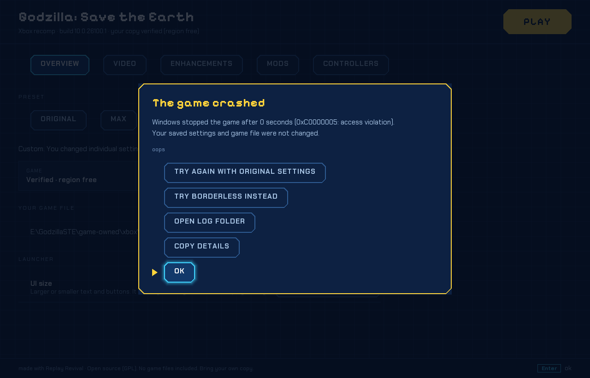

# Player guide

Godzilla: Save the Earth (Xbox), recompiled for Windows. This is an early alpha: expect bugs, and expect it to keep improving.

Not affiliated with or endorsed by Toho, Atari or Pipeworks. **You must own the game.** The download contains no game files.

## What you need
- Windows 10 or 11, 64-bit, a graphics card with Direct3D 11.
- Your own copy of the Xbox game: a disc image (`.iso`) or an extracted folder that contains `default.xbe`.
- About 0.8 GB of free space if you use an `.iso` (it is unpacked once).
- Windows "N" editions need Microsoft's Media Feature Pack.

## Install
1. Unzip the download into a folder you can write to (not Program Files). Keep all the files together.
2. Run `launcher.exe`.

Everything the launcher and game write stays in that folder: `data\` (settings, mods, logs), `saves\`, `shadercache\`. To start over, close the launcher and remove those folders. Your own disc image or game folder is only ever read.

## Add your game
The first time, the launcher asks for your game.

- **Choose disc image** takes your `.iso`. It is checked, then unpacked once into `data\game\`.
- **Choose a folder** takes an already extracted game folder.
- You can also drag an `.iso` or a folder onto the window.

The launcher has its own file browser, which works with a controller, keyboard or mouse. Pick a drive, open folders, and press **USE THIS FOLDER**. The last folders you used are listed under RECENT. **WINDOWS DIALOG** switches to the normal Windows window if you prefer it.

If it says "this is not a game", it is not the Xbox version of *Save the Earth*, or the copy is damaged. Nothing is changed.

## Presets
After that you land on the main screen.

The first time, settings start on **MAX**. Choose:

| Preset | What it is |
|---|---|
| **ORIGINAL** | The game as it was on the console: 4:3, original draw distance, nothing extra. |
| **MAX** | Widescreen, full resolution, unlimited draw distance, 16x texture filtering, everything unlocked. |
| **LOW-END** | Lighter settings for weak graphics cards. |

Picking a preset sets many rows at once; you can still change single rows afterwards. Then press **PLAY**.

## Settings
- **VIDEO**: resolution (starts at your screen's own, ultrawide included), display (which monitor), window / borderless / fullscreen, gameplay view ("Original (4:3)" or "Fit my screen"; menus always stay 4:3), frame limit, V-Sync (on by default), variable refresh rate (needs FreeSync/G-Sync switched on in your driver), render scale and upscaling, draw distance, fog, field of view, texture filtering, and under SOUND AND POINTER the game's volume and whether the mouse pointer hides itself (Auto, always hidden or always shown). Volume and pointer are your own choices: the presets do not change them.
- **ENHANCEMENTS**: unlock options (all monsters, cities, challenges, gallery), cheats, and gameplay tweaks. These are off in ORIGINAL.

Move with the arrow keys or d-pad, change a value with Left/Right, switch tabs with the shoulder buttons (or Q / E).

## Controllers and button prompts
The **CONTROLLERS** tab shows connected pads, per port. You can set the dead zone, turn rumble on or off (TEST RUMBLE checks it) and remap any button: pick a row, press the new button when it says "listening".

**Button prompts** is the name set the game shows on screen: *Auto* (follows the pad you use), *Xbox*, *Original Xbox* (Black / White) or *PlayStation*.

The keyboard works too: arrows = d-pad, Enter = Start, Backspace = Back, Z X C V = A B X Y, Q / E = White / Black, 1 / 3 = triggers, W A S D and I J K L = sticks. Xbox pads are tested; PlayStation, Switch and generic pads are not yet, so tell us what happens.

The whole launcher can be used from a pad.

## Mods
The **MODS** tab installs mods from a `.zip` or a folder, turns them on and off, sets their order and removes them. Removed mods are moved aside, not deleted. A badge says whether a mod works with your game. See [MODDING.md](MODDING.md) for how mods are made. This project ships no mods; modders host their own.

## Updates
Once a day the launcher can look on GitHub for a newer release and show a link on the Overview tab. It sends nothing about you and only opens github.com. Turn it off with the "Check for updates" row on Overview. See [NETWORK.md](NETWORK.md).

## If the game stops
The launcher tells you in plain words what happened and offers:
- **TRY AGAIN WITH ORIGINAL SETTINGS** (your saved settings stay as they are),
- **TRY BORDERLESS INSTEAD**,
- **OPEN LOG FOLDER**,
- **COPY DETAILS**, to paste into a bug report,
- **SAVE CRASH REPORT**, after a crash.

**Save crash report** makes a zip on your desktop with the game's logs, the two settings files and a crash dump. Look it over; you send it yourself, nothing is uploaded. Names and folder paths in the text files are replaced, but the crash dump is a snapshot of memory and may contain your Windows user name. Only send it where you are happy to.

## Troubleshooting
| What you see | What to try |
|---|---|
| "The game program is missing" | Your virus scanner removed it, or the zip was not fully unzipped. Unzip again into a fresh folder. |
| "Not enough space" | Free some space, or unpack to another drive (the browser's unpack-to step lets you choose). |
| Black screen or crash at start | Try **ORIGINAL**, then **TRY BORDERLESS INSTEAD**. Update your graphics driver. |
| A mod is "marked" | It was made for another version of the game, or needs another mod. Details are on the mod's row. |
| Stutter on the first start | Shaders are compiled once into `shadercache\`; later starts are faster. |
| Controller not found | Plug it in before starting the launcher, or press a button on it. Check the CONTROLLERS tab. |
| Windows warns about the download | The file is new and unsigned. Check the SHA-256 on the release page against yours. |

Bug reports: <https://github.com/replayrevival/ste-recomp/issues>. Please include your Windows version, graphics card and what you did before the problem.

Known issues of the current alpha are listed in the release notes.

## The in-game menu
While the game runs, hold **Back and Start** together for a second on any controller (or press **F1**, or the **Guide** button). The game pauses and the launcher's own screens open over it: Video, Enhancements and Controllers (with button pictures and remapping), plus **Return to launcher** and **Quit game**.
- **Volume** and **Mouse pointer** change at once. **Button prompts** and the enhancements apply from the next match. Everything else is saved and used the next time you start the game; each row says which.
- **Return to launcher** asks once more, then closes the game and brings you back to the launcher. Unsaved progress is lost.
- The menu needs `ste_overlay.dll` next to the game program (it is in the download). Without it the game runs as before.
- Back and Start held together are not passed to the game.
